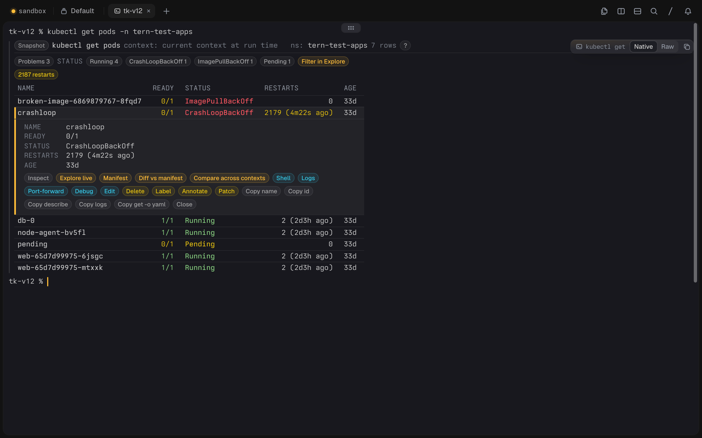
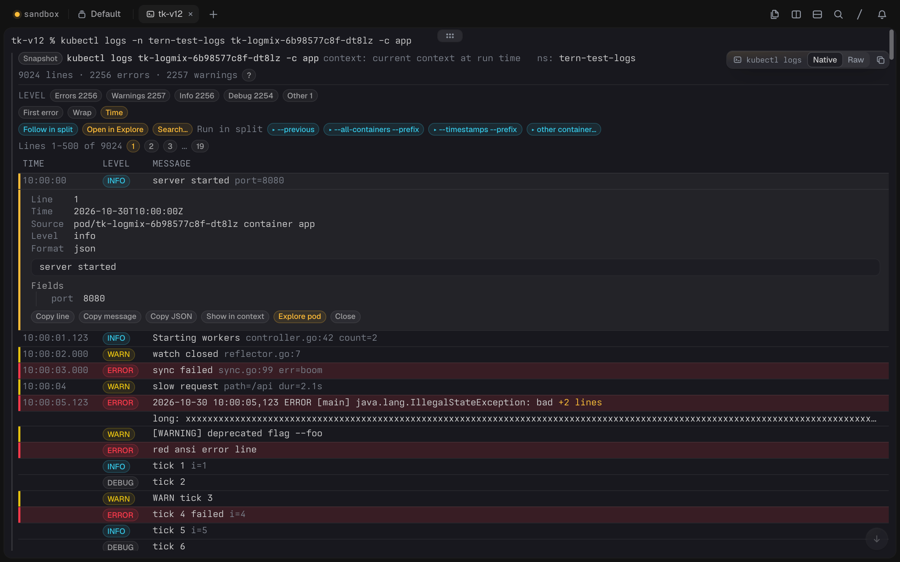
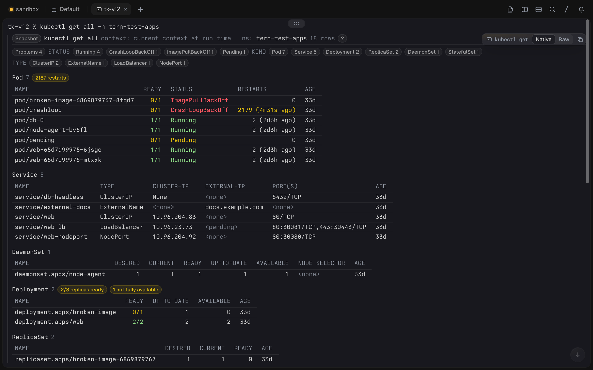
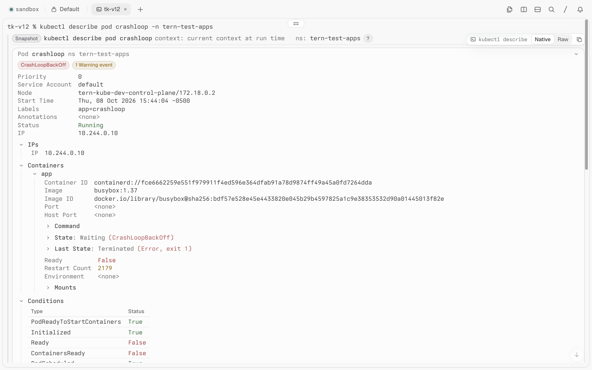
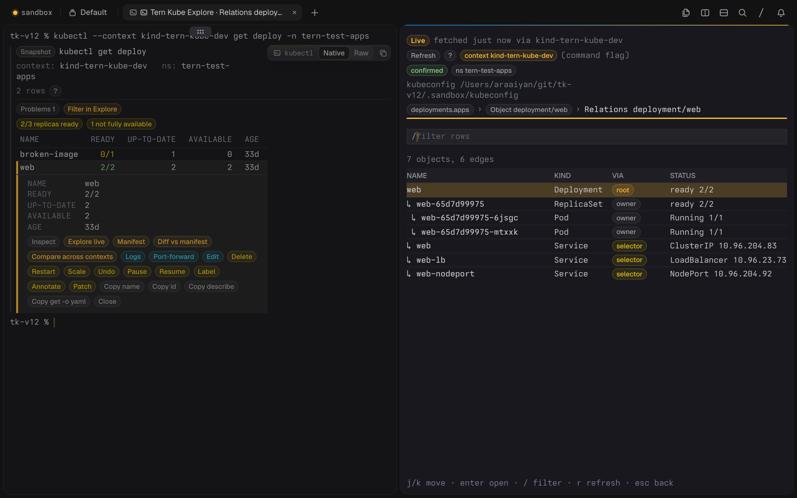
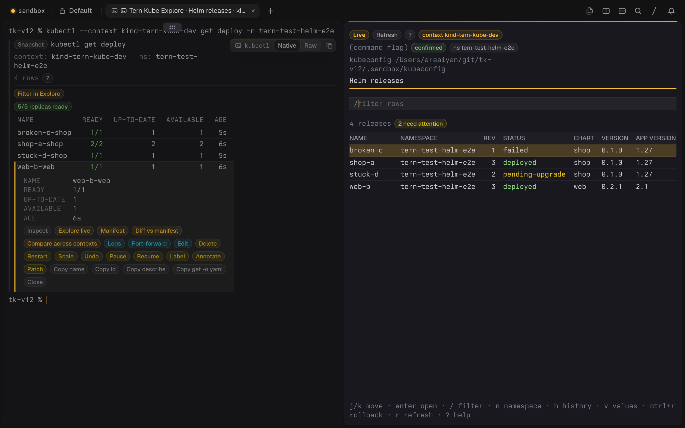
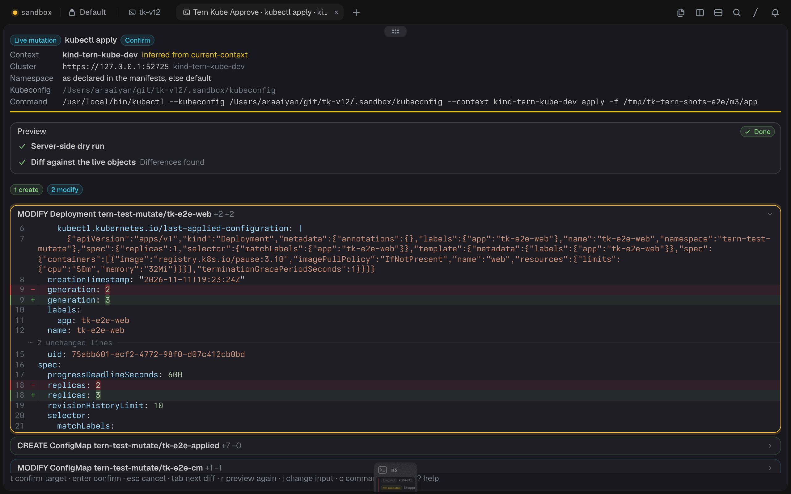
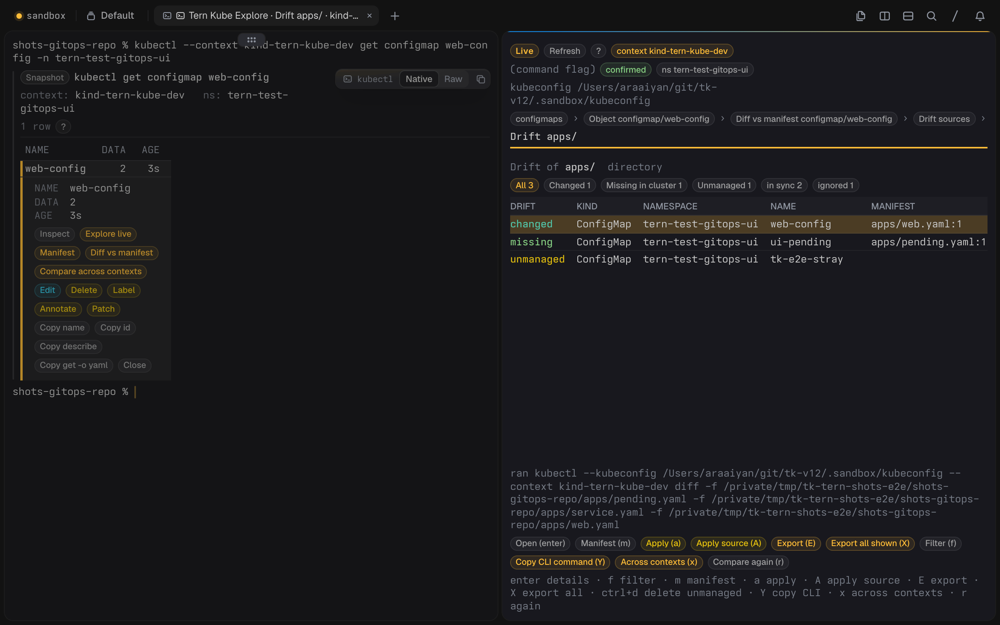

# tern-kube

**Tern Kube** reads `kubectl` output in [Tern](https://stencil.so/tern) as
native views: sortable, filterable tables you can click into, with the
original output one click away (**Raw**).



> Public beta, in active development. See [Features](#features) for what is done and what v1.0 adds.

- **Click a column** to sort. Ages, quantities, ratios and restarts sort by
  value, not text.
- **Click a row** for an inline inspector; **Inspect** shows every field,
  the source line and, with `-o json`, the object tree.
- **Filter chips** by status, namespace and kind, plus **Problems**
  (failing, not ready, restarting).
- **Copy** the name, a qualified id, or a ready `describe`, `logs` or
  `get -o yaml` command for the same context and namespace.
- `describe` renders as cards with an events timeline, `-o yaml` as a
  document list, and `apply` / `delete` / `scale` / `rollout restart` as a
  result summary (a result, never a preview).
- Secret values are masked in the native view.
- `kubectl logs` renders as records: level, source, time and parsed JSON,
  klog or logfmt fields, level and source chips, **First error**, a row
  inspector with copy chips, and variants (other container, `--previous`)
  run in a split. `kubectl events` and `get events` link each row to its
  object.
- `logs -f` and event watches show raw while they run and turn native when
  they stop; other watches, `-o jsonpath` and very large tables stay raw.

It claims `kubectl` and `kubecolor` running `get`, `describe`, `top`,
`logs`, `events`, `apply`, `delete`, `rollout restart` and `scale`, also
after global flags (`kubectl --context prod -n web get pods`), and takes
over from Tern's built-in `kubectl get` and `kubectl logs` lenses.
Pipelines and redirected output are never lensed.



| `get all` | `describe` |
| --- | --- |
|  |  |

## Explore

**Explore live** on a row, or **Tern Kube: Explore** in the palette, opens a
live block beside the pane. It pins the context it queries, shows where that
context came from, and only refreshes when you ask.



| Keys | |
| --- | --- |
| `j` `k` `gg` `G` `enter` `esc` | move, open, back |
| `/` | filter |
| `d` `y` `L` `R` | describe, object, logs, relations |
| `v` `V` | namespace events, events of the focused object |
| `s` `l` `shift+f` | shell, follow logs, port-forward in a split |
| `c` `n` `:` | context, namespace, kind |
| `ctrl+d` `ctrl+r` `shift+s` | delete, rollout restart, scale |
| `e` | edit in a split, approve after saving |
| `t` `T` `X` | label, annotate, patch |
| `U` `p` `P` | rollout undo, pause, resume |
| `C` `u` `D` | cordon, uncordon, drain |
| `H` | Helm releases (palette: **Tern Kube: Helm releases**); on a Helm-managed object, its release |
| `r` `Y` `?` | refresh, copy the command, help |

In logs (`L`): `]` `[` next/previous error, `x` level floor, `a` container,
`o` previous instance, `w` wrap, `/` search, `enter` inspector. In events
(`v` `V`): `x` Warnings only, `]` `[` next/previous Warning, `/` filter,
`enter` opens the object. In Helm views (`H`): `h` history, `v` values
(again: next mode), `M` manifest, `N` notes, `K` hooks, `R` resources, `=`
revision diff, `space` marks a revision to diff against, `ctrl+r` rollback,
`ctrl+g` drift of the detected chart. Secret values stay masked.



Inside the GitOps views (drift, export, git), a view's own keys take
precedence: there `t`, `X`, `e`, `p` and `P` keep their view meaning.

Shell, logs and port-forward are also chips in the lens inspector (two
clicks from any row). They open beside the pane by default; see
[configuration](docs/configuration.md).

## Changes

Delete, rollout restart/undo/pause/resume, scale, patch, label, annotate,
cordon, uncordon, drain, debug, CronJob run-now (Explore keys or inspector
chips) and **Tern Kube: Apply file or directory** open an approval block
first: server dry run, `kubectl diff` or a before/after object diff per
resource, then a confirmation scaled to the risk. Edit (`e` or the Edit
chip) opens `kubectl edit` in a split; after you save, the approval block
shows the diff before kubectl applies it. Deletes and other broad changes need the target typed.
Helm rollback (`ctrl+r` on a release or revision) shows the recorded change
between the two revisions and the live `kubectl diff`, then needs the release
name typed.
Nothing runs if the preview fails or the inputs or target change before
you confirm.



Typed commands can get the same preview with the opt-in shell guard for
zsh, bash and fish: `kubectl apply`, `delete`, `scale`, `patch`, `label`,
`annotate`, `cordon`, `uncordon`, `drain`, `rollout restart|undo|pause|resume`
and `edit` (after you save) wait for your approval in Tern; everything else
runs untouched. It is a seatbelt, not a policy: `command kubectl` and scripts
bypass it. Setup: [shell/README.md](shell/README.md).

## GitOps

Explore knows the git repository you ran the command in: `m` opens an
object's manifest at its line, `=` diffs it against the live object,
`ctrl+g` reports drift for a directory, Kustomization, Helm chart or a
locally checked out Argo CD / Flux app (changed, missing, unmanaged), and
`E` exports live objects as clean manifests, optionally onto a new branch
and commit. Chart directories are matched to deployed releases on their
own and rendered with the deployed values or a values file next to them.
Push and pull requests are off unless you turn them on.



Outside Tern, [`bin/tern-kube-drift`](bin/tern-kube-drift) produces the same
report for CI ([example workflow](examples/ci/github-actions-drift.yml)).
Details: [docs/gitops.md](docs/gitops.md).

## Install

```sh
tern plugin install github.com/contrafy/tern-kube
```

Installing copies the whole repository (about 6 MB); Tern loads only
`plugin.toml` and `plugin/`.

Requires Tern 0.9 or later (tested on 0.9.8) with shell integration and native command
output on (`command_lenses`, the default), and `kubectl` installed. Started
from the Dock or Finder, Tern has a minimal `PATH`; tern-kube reads yours
from your login shell ([Programs and `PATH`](docs/configuration.md#programs-and-path)).
Tested on macOS (window and panes) and on Debian 13 remote hosts with fish,
bash and zsh login shells.

The shell guard, `tern-kube-drift` and the bash/fish alias helper live
outside the plugin; clone the repository for those:

```sh
git clone https://github.com/contrafy/tern-kube
tern-kube/scripts/tern-kube-aliases add k   # bash/fish only; zsh expands aliases itself
```

Settings: **Tern Kube: Settings** in the palette, or edit
`~/.config/tern-kube/config.json`, created on first load with a `$schema`
line so editors complete and check every key
([configuration](docs/configuration.md)).

To remove: `tern plugin remove tern-kube`.

### On a remote host

Panes on a host added with `tern remote setup user@host` run that host's
`kubectl` and kubeconfig, so the host half must be installed there too. In a
pane on the host:

```sh
"$TERN_EXE" plugin install github.com/contrafy/tern-kube
```

Keep the local install: the window half (quick actions, links, block
placement) runs on your machine. Install the same tern-kube version on
both. Limits and troubleshooting: [remote hosts](docs/remote-hosts.md).

## Features

v1.0 is when every row reads done. Release history: [CHANGELOG.md](CHANGELOG.md).

| Feature | Status |
| --- | --- |
| **Lens** | |
| `get`, `describe`, `top`, mutation results as native views | done |
| Claims `kubectl` and `kubecolor`, also after global flags | done |
| Typed column sort; status, namespace, kind, Problems filters | done |
| Inline row inspector and full Inspect view | done |
| Copy name, id, `describe`/`logs`/`get -o yaml` command | done |
| `describe` cards with events; YAML list; JSON tree | done |
| Secrets masked; raw fallback for watches, jsonpath, huge output | done |
| Narrow-window columns; view state survives plugin reload | done |
| Native `kubectl logs` lens | done |
| **Explore** | |
| Live block with pinned context and its provenance | done |
| k9s-style keys; context, namespace and kind pickers | done |
| Describe, object, parsed logs (`explore.logs_tail` lines) | done |
| Relations graph with provenance | done |
| Namespace events timeline | done |
| Helm releases with history | done |
| Compare one object across contexts | planned |
| **Quick actions** | |
| Pod shell; workloads pick a ready pod | done |
| Follow logs; workloads by selector, all containers | done |
| Port-forward with port picker and local port suggestion | done |
| Debug container, node debug pod, CronJob run now | done |
| New split (right, down) or tab; context and kubeconfig pinned | done |
| **Changes (mutations)** | |
| Delete, rollout restart/undo/pause/resume, scale, patch, label, annotate from Explore keys or lens chips | done |
| **Tern Kube: Apply file or directory**, Kustomize included | done |
| Approve block: server dry run, per-resource `kubectl diff` | done |
| Risk tiers; re-verifies argv, target and files before running | done |
| JSON-lines audit log | done |
| Before/after object diffs for `patch`, `label`, `annotate`, `rollout undo`/`pause`/`resume` | done |
| `cordon`, `uncordon`, `drain` with eviction and PodDisruptionBudget preview; `edit` as preview then apply | done |
| Helm rollback through the approve block | done |
| **Shell guard** | |
| Opt-in for zsh, bash and fish; one POSIX `sh` core | done |
| Guards `apply`, `delete`, `scale`, `rollout restart` | done |
| Fails closed outside Tern, on timeout or mismatch | done |
| Guards `rollout undo`/`pause`/`resume`, `patch`, `label`, `annotate`, `cordon`, `uncordon`, `drain`, `edit` | done |
| **GitOps** | |
| Manifest index: YAML, Kustomize, configured or auto-detected Helm releases | done |
| Open manifest at its line; diff vs live object | done |
| Drift report: changed, missing, unmanaged; apply via approve | done |
| Argo CD / Flux owner, sync and health status | done |
| Export clean manifests; Secrets as placeholders | done |
| Branch and commit; push and `gh pr create` opt-in | done |
| `tern-kube-drift` CLI (text, Markdown, JSON) and CI example | done |
| Helm values diff and chart auto-detect | done |
| Compare one source against several clusters | planned |
| **Settings and config** | |
| Versioned JSON at `~/.config/tern-kube/config.json`, with a JSON Schema | done |
| **Tern Kube: Settings**: validation, reset, status checks | done |
| Opt-in bash/fish alias claims (`tern-kube-aliases`) | done |
| Mutation and live-query switches, timeouts, limits | done |
| **Platform** | |
| Tern on macOS; CI on macOS arm64, Linux x86_64 and Debian 13 shells (fish 4, dash, mawk) | done |
| Tern on Linux hosts (remote; Debian 13 verified)[^linux] | done |
| Remote SSH hosts ([limits](docs/remote-hosts.md#limitations)) | done |
| fish as login shell | done |

[^linux]: Linux desktop window: same window half, not verified locally.

| Kind | Lens | Relations | Shell/logs | Port-fwd | Rollout/scale | Edit/label/patch | Cordon/drain | Delete | Manifest |
| --- | --- | --- | --- | --- | --- | --- | --- | --- | --- |
| Pods | done | done | done | done | - | done | - | done | done |
| Deployments | done | done | done | done | done | done | - | done | done |
| StatefulSets | done | done | done | - | done | done | - | done | done |
| DaemonSets | done | done | done | - | done | done | - | done | done |
| ReplicaSets | done | done | done | - | done | done | - | done | done |
| Jobs | done | done | done | - | - | done | - | done | done |
| CronJobs | done | done | - | - | - | done | - | done | done |
| Services | done | done | - | done | - | done | - | done | done |
| Ingresses | done | done | - | - | - | done | - | done | done |
| Nodes | done | partial | done | - | - | done | done | done | - |
| Namespaces | done | - | - | - | - | done | - | done | done |
| ConfigMaps | done | partial | - | - | - | done | - | done | done |
| Secrets | done | partial | - | - | - | done | - | done | done |
| Events | done | - | - | - | - | - | - | - | - |
| Custom resources | done | partial | - | - | - | done | - | done | done |
| Helm releases | - | done | - | - | - | - | - | - | partial |

`-`: not applicable or outside v1.0. partial: Nodes, ConfigMaps and Secrets
appear only as relations of Pods; custom resources show owners only; Helm
releases diff and drift but do not export. Node shell is a debug pod.

## Development

```sh
make bootstrap   # pinned tools into .tools/
make check       # format, lint, typecheck, unit tests, benchmark
make e2e         # drives an isolated Tern window; needs Docker
tern plugin link .   # load the checkout in place; reloads on save
```

`make e2e` runs against a disposable [kind](https://kind.sigs.k8s.io)
cluster (`scripts/cluster.sh create`) and refuses any other context.

More: [architecture](docs/architecture.md), [security model](docs/security-model.md),
[testing](docs/testing.md), [SDK capability matrix](docs/sdk-capability-matrix.md),
[performance](docs/performance.md), [contributing](CONTRIBUTING.md).

## License

[MIT](LICENSE)
