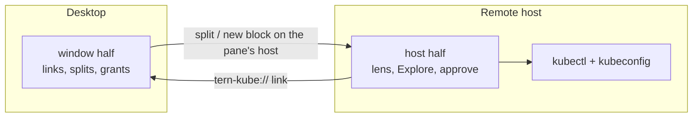

# Remote hosts

Tern can open panes on another machine (`tern remote setup user@host`).
tern-kube works there: lenses, Explore, Settings, approvals and quick
actions run against the remote host's `kubectl`, kubeconfig and config.
Verified with a Debian 13 host (fish, bash and zsh login shells) and a macOS
window.

## What runs where

| Half | Runs on | Does |
| --- | --- | --- |
| Host (`plugin/host.luau`) | the machine of the pane | lenses, Explore, approve and Settings blocks, `kubectl`/`helm` calls, audit log, guard spool, `~/.config/tern-kube/config.json` of that machine |
| Window (`plugin/window.luau`) | your desktop | `tern-kube://` links, quick-action splits, grant tokens, palette commands |



A quick action clicked on a remote row opens its split on the remote host;
the window finds the pane's host in the host's pane list. Blocks opened from
the window (approve, Explore from the palette, Settings) open on the window's
current host.

## Install both halves

Locally, as usual:

```sh
tern plugin install github.com/contrafy/tern-kube
```

On the host, in a Tern pane there (same line in fish, bash and zsh):

```sh
"$TERN_EXE" plugin install github.com/contrafy/tern-kube
```

`tern remote setup` puts `tern` in `~/.local/bin`, often not on a login
shell's `PATH`; Tern sets `TERN_EXE` in every pane. Install the same
tern-kube version on both machines: the approve block refuses a quick
action whose link carries no grant token (an older window half).

## Which config applies

Each machine reads its own `~/.config/tern-kube/config.json`.

- Host-scoped (the pane's machine): everything the lens, Explore, approve
  and Settings blocks use, including `quick_actions.placement`,
  `quick_actions.logs_tail` and `quick_actions.debug_image` (they travel in
  the link), `mutations`, `security`, `explore`, `gitops`, `helm`, programs
  and `PATH`.
- Window-scoped: `quick_actions.shell_command` (never read from a link).

Settings opened on a remote host shows and edits the remote file.

## Shell guard

Source the snippet from the remote install, e.g. in fish:

```fish
source ~/.config/tern/plugins/tern-kube/shell/tern-kube.fish
```

The guard finds Tern as `${TERN_BIN:-${TERN_EXE:-tern}}`, so it works without
`tern` on `PATH`. See [shell/README.md](../shell/README.md#on-a-remote-host).

## Login shells

fish, bash and zsh login shells are supported on both machines. tern-kube
reads `PATH` from the login shell (`fish -l -c` for fish); Settings shows
`Shell PATH read from <shell>`. Quick-action command lines are quoted so
fish parses them too.

## Limitations

- No per-pane `KUBECONFIG` record on remote panes. Quick actions from a
  remote pane use the remote login shell's `KUBECONFIG` (or
  `~/.kube/config`); the split prints
  `tern-kube: <host>: kubeconfig from the login environment`. A
  `KUBECONFIG` exported only in that pane is not seen. Locally the pane
  record still pins `--kubeconfig`.
- Port-forward listens on the remote host. The split prints the ssh tunnel
  to run on your machine, e.g.
  `tern-kube: from this machine: ssh -N -L 8080:localhost:8080 -p 2222 tk@localhost`.
- The remote Tern may be newer than the window's: `tern remote setup`
  installs the build service's current version (verified: window 0.9.8,
  host 0.9.10, same 0.9 line). Keep both on the same minor line.
- Tern connects to the host through iroh (UDP 8376 and the relay); a
  firewall that blocks it leaves the host disconnected.

## Troubleshooting

- `tern remote doctor`: host reachability, version and serve process.
- "Could not open the block ... No plugin on <host>" or "Tern Kube is not
  loaded on this host": install the plugin on that host (above), then
  `"$TERN_EXE" plugin list` there.
- Approve block: "opened without a confirmation token": update tern-kube on
  the window machine to the host's version.
- Guard: "tern ... failed": check `tern-kube-guard status`; the `tern:` line
  names the binary and whether it came from `TERN_BIN`, `TERN_EXE` or
  `PATH`.
- Explore `e` on a remote pane: "<host> has no TKUBE_GUARD_CORE": the edit
  split runs the guard core of the remote install, which sets
  `TKUBE_GUARD_CORE` in its panes; install or update tern-kube there.
